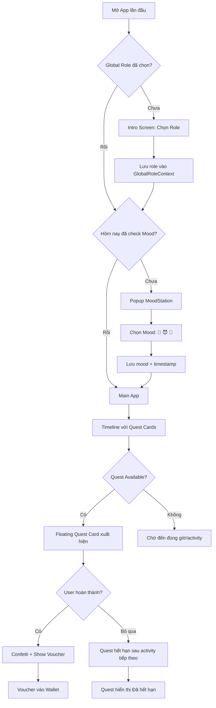
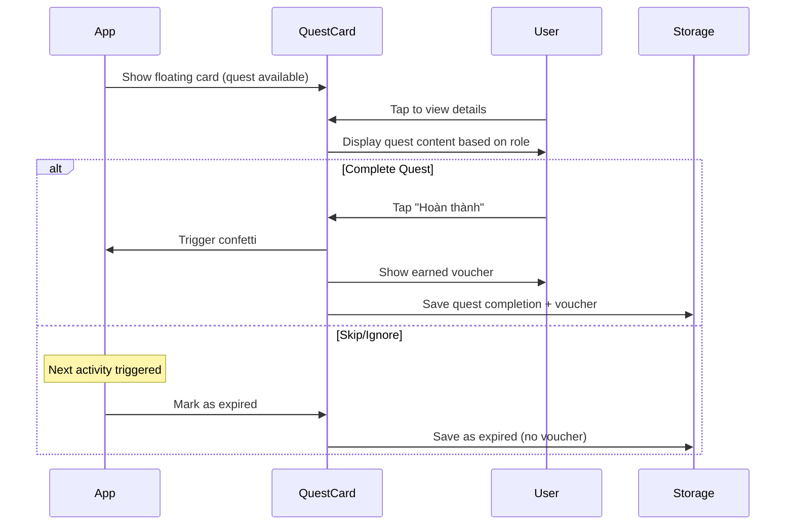

# 🎯 PRD: Daily Quest System + Global Role Selection

> **Document Version:** 1.0
> **Author:** AI BA/Tech Lead
> **Created:** 2026-01-14
> **Based on:** 3 vòng phân tích hành vi người dùng

---

## 1. TỔNG QUAN

### 1.1 Vấn đề cần giải quyết

| #   | Pain Point                                                                        | Severity  |
| :-- | :-------------------------------------------------------------------------------- | :-------: |
| 1   | Thiếu **Global Role State** - Phải chọn role Anh/Em mỗi lần vào feature khác nhau |  🔴 High  |
| 2   | Timeline hiện tại **chỉ hiển thị thông tin** - Không có tương tác gamification    | 🟡 Medium |
| 3   | Thiếu **engagement hàng ngày** - Không có lý do để mở app thường xuyên            | 🟡 Medium |
| 4   | **Mood-based filtering** chưa có - Spicy level cứng nhắc                          | 🟡 Medium |

### 1.2 Solution Summary

```
┌─────────────────────────────────────────────────────────────────────────┐
│  DAILY QUEST SYSTEM + GLOBAL ROLE SELECTION                            │
│                                                                         │
│  ┌─────────────┐   ┌──────────────┐   ┌────────────────┐               │
│  │ Global Role │ → │ Mood Filter  │ → │ Timeline Quest │ → Voucher     │
│  │  Selection  │   │ (Daily)      │   │  (FOMO)        │   Reward      │
│  └─────────────┘   └──────────────┘   └────────────────┘               │
│                                                                         │
│  ✓ Chọn role 1 lần ở Intro          ✓ Mood check-in mỗi ngày          │
│  ✓ Apply toàn app                   ✓ Quest gắn với Timeline/Activity  │
│  ✓ UI + Content khác biệt           ✓ Miss = Mất (FOMO mechanic)       │
└─────────────────────────────────────────────────────────────────────────┘
```

### 1.3 Constraints (Ràng buộc kỹ thuật)

> [!IMPORTANT] > **Frontend-Only / Offline-First**
>
> - Không có Backend
> - Vùng sóng yếu/không có mạng
> - Tất cả dữ liệu lưu localStorage
> - Không upload ảnh/video

> [!WARNING] > **Content Rules (Voucher/Action)**
>
> - ❌ Không quay phim/chụp ảnh nude
> - ❌ Không nhảy nhót
> - ❌ Không bẩn thỉu quá mức
> - ❌ Không từ tiếng Anh không giải thích
> - ❌ Không bắn vào trong (chỉ lên ngực/miệng)
> - ❌ Không trói

---

## 2. USER FLOW

### 2.1 Flow tổng quan



### 2.2 Role Selection Flow

**Trigger:** Lần đầu mở app HOẶC chưa có role trong localStorage

**UI Reference:** Tham khảo [BudgetRoleSelector.tsx](/src/components/budget/BudgetRoleSelector.tsx)

```
┌───────────────────────────────────────────────────────────┐
│                   Chọn vai trò của bạn                    │
│          Vai trò sẽ ảnh hưởng đến toàn bộ app            │
├─────────────────────────┬─────────────────────────────────┤
│                         │                                 │
│   ┌─────────────────┐   │   ┌─────────────────┐          │
│   │     ❄️ Anh      │   │   │     🌸 Em       │          │
│   │                 │   │   │                 │          │
│   │  Cloud Blue     │   │   │  Misty Pink     │          │
│   │                 │   │   │                 │          │
│   │  Chủ động       │   │   │  Được chiều     │          │
│   │  Hoàn thành     │   │   │  Nhận reward    │          │
│   │  nhiệm vụ       │   │   │  từ Anh         │          │
│   └─────────────────┘   │   └─────────────────┘          │
│                         │                                 │
└─────────────────────────┴─────────────────────────────────┘
```

### 2.3 Mood Check-in Flow

**Trigger:** Lần đầu mở app TRONG MỖI NGÀY (check date)

**UI Reference:** Tích hợp vào [MoodStation.tsx](/src/components/MoodStation.tsx)

**Mood Options:**

| Mood         | Icon | Ảnh hưởng đến Quest          |
| :----------- | :--: | :--------------------------- |
| **Lãng mạn** |  🥰  | Ưu tiên quest cute, romantic |
| **Naughty**  |  😈  | Thêm quest spicy vào pool    |
| **Vui vẻ**   |  🤗  | Mix đều các loại quest       |

---

## 3. FEATURE SPECIFICATIONS

### 3.1 Global Role System

#### 3.1.1 Yêu cầu chức năng

| ID    | Requirement                                                   | Priority |
| :---- | :------------------------------------------------------------ | :------: |
| GR-01 | Hiển thị modal chọn role ở Intro nếu chưa có role             |    P0    |
| GR-02 | Lưu role vào localStorage, persist across sessions            |    P0    |
| GR-03 | Áp dụng role cho TẤT CẢ features (Budget, Passport, Games...) |    P0    |
| GR-04 | KHÔNG có option swap role (B từ Round 2 E4)                   |    P1    |
| GR-05 | Refactor các component hiện tại để dùng global role           |    P0    |

#### 3.1.2 Role Differences

| Aspect            | Anh (❄️)                      | Em (🌸)                           |
| :---------------- | :---------------------------- | :-------------------------------- |
| **UI Color**      | `cyan-500`, `blue-500`        | `pink-500`, `rose-500`            |
| **Quest Content** | Nhiệm vụ CHỦ ĐỘNG (làm gì đó) | Nhiệm vụ THỤ ĐỘNG (nhận/đánh giá) |
| **Reward Type**   | Voucher CHO Em                | Voucher NHẬN từ Anh               |
| **Dominance**     | Completing tasks              | Receiving rewards                 |

### 3.2 Daily Quest System

#### 3.2.1 Quest Structure

**Quest per Day (D from Round 3 H1):**

| Day   | Theme       | Quest Count | Notes                              |
| :---- | :---------- | :---------: | :--------------------------------- |
| Day 1 | Hibernation |     2-3     | Ít quest (nghỉ ngơi)               |
| Day 2 | Birthday    |     4-5     | Nhiều quest (sự kiện chính)        |
| Day 3 | Adventure   |     4-5     | Nhiều quest (hoạt động ngoài trời) |
| Day 4 | Farewell    |      2      | Ít quest (về HN)                   |

#### 3.2.2 Quest Timing

**Gắn với Timeline (H2: A+B):**

Quest được kích hoạt dựa trên:

1. **Mốc thời gian cụ thể** trong `itinerary.ts`
2. **Hoàn thành hoạt động** (sau khi check-in, sau bữa ăn...)

```typescript
interface DailyQuest {
  id: string;
  dayId: number;

  // Timing
  triggerType: "time" | "activity";
  triggerTime?: string; // "14:00" for time-based
  triggerActivityId?: string; // Reference to TimelineItem

  // Expiry (FOMO)
  expiresAt: "next_activity" | "end_of_day";

  // Content
  questType: "photo" | "journal" | "service" | "sensual";
  titleAnh: string;
  titleEm: string;
  descriptionAnh: string;
  descriptionEm: string;

  // Mood filter
  requiredMood?: MoodType[]; // null = all moods
  minSpicyLevel?: 1 | 2 | 3;

  // Reward
  reward: VoucherReward;
}
```

#### 3.2.3 Quest Content Types

**Từ Round 3 I1-I4:**

| Type           | Anh Action                              | Em Action        |          Spicy Time           |
| :------------- | :-------------------------------------- | :--------------- | :---------------------------: |
| **Photo** 📸   | Chụp + Confirm "đã chụp"                | Được chụp + Rate |              Any              |
| **Journal** ✍️ | Viết/Voice note → localStorage          | Viết/Voice note  |              Any              |
| **Service** 🎁 | Thực hiện phục vụ (massage, gội đầu...) | Nhận + Đánh giá  |              Any              |
| **Sensual** 🔥 | Thực hiện action intimate               | Nhận + Enjoy     | After 20:00 OR manual trigger |

#### 3.2.4 Quest Completion Flow



### 3.3 Mood-based Filtering

#### 3.3.1 Mood System

**Từ Round 3 J1-J4:**

```typescript
type MoodType = "romantic" | "naughty" | "playful";

interface MoodState {
  currentMood: MoodType;
  lastCheckedAt: number; // timestamp
  lastCheckedDate: string; // "2026-01-15" for daily reset
}
```

**Mood → Quest Filtering (Priority-based, not hard filter):**

| Mood        | Quest Pool Weighting                      |
| :---------- | :---------------------------------------- |
| 🥰 Romantic | 60% cute/romantic, 30% service, 10% spicy |
| 😈 Naughty  | 40% spicy, 30% service, 30% romantic      |
| 🤗 Playful  | Equal distribution                        |

#### 3.3.2 Mood Check Trigger

```typescript
// Check on app open
function shouldShowMoodCheckin(): boolean {
  const today = new Date().toISOString().split("T")[0]; // "2026-01-15"
  const lastCheckedDate = localStorage.getItem(STORAGE_KEYS.MOOD.LAST_DATE);
  return lastCheckedDate !== today;
}
```

---

## 4. TECHNICAL SPECIFICATIONS

### 4.1 New Files to Create

| Path                                      | Description                      |
| :---------------------------------------- | :------------------------------- |
| `src/contexts/GlobalRoleContext.tsx`      | Context cho Global Role state    |
| `src/contexts/DailyQuestContext.tsx`      | Context cho Quest state          |
| `src/contexts/MoodContext.tsx`            | Context cho Mood state           |
| `src/components/GlobalRoleSelector.tsx`   | UI chọn role ở Intro             |
| `src/components/DailyQuestCard.tsx`       | Floating quest card              |
| `src/components/QuestCompletionModal.tsx` | Modal hiện reward khi hoàn thành |
| `src/data/dailyQuests.ts`                 | Quest data theo ngày             |
| `src/hooks/useDailyQuest.ts`              | Hook quản lý quest logic         |

### 4.2 Files to Modify

| Path                             | Changes                                   |
| :------------------------------- | :---------------------------------------- |
| `src/config/storage.ts`          | Thêm STORAGE_KEYS cho Role, Quest, Mood   |
| `src/layouts/RootLayout.tsx`     | Wrap với GlobalRoleProvider, MoodProvider |
| `src/contexts/BudgetContext.tsx` | Dùng global role thay vì local role       |
| `src/components/MoodStation.tsx` | Tích hợp với MoodContext                  |
| `src/pages/IntroPage.tsx`        | Thêm GlobalRoleSelector                   |

### 4.3 TypeScript Interfaces

```typescript
// src/types/quest.ts

import type { VoucherReward } from "./game";

export type GlobalRole = "anh" | "em";
export type MoodType = "romantic" | "naughty" | "playful";
export type QuestType = "photo" | "journal" | "service" | "sensual";
export type QuestStatus = "locked" | "available" | "completed" | "expired";

export interface DailyQuest {
  id: string;
  dayId: number;

  // Timing
  triggerType: "time" | "activity";
  triggerTime?: string;
  triggerAfterActivity?: string;
  expiresAt: "next_activity" | "end_of_day";

  // Content
  questType: QuestType;
  titleAnh: string;
  titleEm: string;
  descriptionAnh: string;
  descriptionEm: string;

  // Filtering
  allowedMoods?: MoodType[];
  minSpicyLevel?: 1 | 2 | 3;
  timeRestriction?: "after_20:00" | "private_room";

  // Reward
  reward: VoucherReward;
}

export interface QuestProgress {
  questId: string;
  status: QuestStatus;
  completedAt?: number;
  journalEntry?: string; // For journal quests
  voiceNoteId?: string; // For voice notes
}

export interface GlobalRoleState {
  role: GlobalRole | null;
  selectedAt: number | null;
}

export interface MoodState {
  currentMood: MoodType | null;
  lastCheckedDate: string | null;
}

export interface DailyQuestState {
  progress: Record<string, QuestProgress>;
  currentDayId: number;
}
```

### 4.4 Storage Keys

```typescript
// Additions to src/config/storage.ts

export const STORAGE_KEYS = {
  // ... existing keys

  GLOBAL_ROLE: {
    STATE: `${PREFIX_STORAGE_VERSION}_global_role`,
  },
  MOOD: {
    STATE: `${PREFIX_STORAGE_VERSION}_mood_state`,
    LAST_DATE: `${PREFIX_STORAGE_VERSION}_mood_last_date`,
  },
  DAILY_QUEST: {
    PROGRESS: `${PREFIX_STORAGE_VERSION}_daily_quest_progress`,
  },
} as const;
```

### 4.5 Context Providers Structure

```typescript
// Updated RootLayout.tsx structure

<GlobalRoleProvider>
  <TripProvider>
    <MoodProvider>
      <DailyQuestProvider>
        <BudgetProvider>
          {/* ... existing providers */}
          <AnimatedOutlet />
        </BudgetProvider>
      </DailyQuestProvider>
    </MoodProvider>
  </TripProvider>
</GlobalRoleProvider>
```

---

## 5. UI/UX SPECIFICATIONS

### 5.1 Global Role Selector

**Style Reference:** [BudgetRoleSelector.tsx](/src/components/budget/BudgetRoleSelector.tsx)

```tsx
// Liquid Glass style
<motion.button
  className={cn(
    "relative p-4 rounded-2xl overflow-hidden",
    "bg-gradient-to-br from-cyan-500/20 to-blue-500/10", // Anh
    "border border-cyan-500/30 hover:border-cyan-500/50",
    "transition-all duration-300"
  )}
>
  <div className="flex flex-col items-center gap-3">
    <div className="w-14 h-14 rounded-xl bg-cyan-500/20 flex items-center justify-center">
      ❄️
    </div>
    <p className="text-lg font-display text-cyan-300">Tôi là Anh</p>
    <p className="text-[10px] text-white/40">Chủ động hoàn thành nhiệm vụ</p>
  </div>
</motion.button>
```

### 5.2 Quest Card (Floating)

**Trigger:** Khi quest available + đúng thời điểm

**Position:** Floating overlay trên Timeline

```
┌──────────────────────────────────────┐
│  ✨ NHIỆM VỤ MỚI                     │
├──────────────────────────────────────┤
│                                      │
│  📸 Chụp ảnh nàng thơ bên lò sưởi    │
│                                      │
│  "Anh chụp cho em một tấm ảnh        │
│   với cốc trà nóng, em nhắm mắt      │
│   tận hưởng khoảnh khắc này nhé"     │
│                                      │
│  ⏰ Hết hạn: Khi bắt đầu ăn tối      │
│                                      │
│  ┌────────────┐  ┌────────────┐      │
│  │  Bỏ qua    │  │ Hoàn thành │      │
│  └────────────┘  └────────────┘      │
└──────────────────────────────────────┘
```

### 5.3 Quest Completion

**Effect:** Confetti animation (từ Round 3 K3: B+C)

**Show:** Voucher card with "Đã nhận" animation

```
┌──────────────────────────────────────┐
│          🎉 HOÀN THÀNH! 🎉           │
├──────────────────────────────────────┤
│                                      │
│  ┌────────────────────────────────┐  │
│  │    🎁                          │  │
│  │    Voucher Massage Bàn Tay     │  │
│  │                                │  │
│  │    Em dùng đôi tay mềm mại     │  │
│  │    massage vai cho Anh 💆‍♂️      │  │
│  └────────────────────────────────┘  │
│                                      │
│       [ Thêm vào Ví Voucher ]        │
│                                      │
└──────────────────────────────────────┘
```

### 5.4 Expired Quest Display

**Style:** Greyed out với label "Đã hết hạn"

```typescript
// K4: C - Show with expired label
<div className={cn("glass-panel p-4 rounded-xl", "opacity-50 grayscale")}>
  <div className="flex items-center gap-2">
    <span className="text-red-400">⏰</span>
    <span className="text-white/50 line-through">{quest.title}</span>
  </div>
  <p className="text-xs text-red-400/70 mt-1">Đã hết hạn</p>
</div>
```

---

## 6. SAMPLE QUEST DATA

### 6.1 Day 1 Quests (Hibernation)

```typescript
export const day1Quests: DailyQuest[] = [
  {
    id: "day1_photo_checkin",
    dayId: 1,
    triggerType: "activity",
    triggerAfterActivity: "day1_checkin", // After check-in homestay
    expiresAt: "next_activity",
    questType: "photo",
    titleAnh: "Nhiếp Ảnh Gia Tại Gia",
    titleEm: "Nàng Thơ Đầu Tiên",
    descriptionAnh: "Chụp cho Em một tấm ảnh với phòng mới. Góc nào đẹp nhất?",
    descriptionEm:
      "Tạo dáng thoải mái trong không gian mới. Anh sẽ lưu lại khoảnh khắc này!",
    reward: {
      id: "voucher_foot_massage",
      title: "Voucher Massage Chân",
      description: "Em xoa bóp đôi chân mỏi mệt của Anh sau quãng đường dài.",
      icon: "🦶",
      isRedeemed: false,
      isUsed: false,
    },
  },
  {
    id: "day1_journal_firstnight",
    dayId: 1,
    triggerType: "time",
    triggerTime: "21:00",
    expiresAt: "end_of_day",
    questType: "journal",
    titleAnh: "Nhật Ký Đêm Đầu",
    titleEm: "Cảm Xúc Đêm Đầu",
    descriptionAnh: "Ghi lại cảm xúc của Anh về ngày đầu tiên bên Em ở Sapa.",
    descriptionEm: "Em thấy thế nào? Ghi lại để sau này đọc lại nhé!",
    reward: {
      id: "voucher_morning_kiss",
      title: "Voucher Nụ Hôn Buổi Sáng",
      description:
        "Anh được quyền đánh thức Em bằng nụ hôn ngọt ngào vào sáng mai.",
      icon: "💋",
      isRedeemed: false,
      isUsed: false,
    },
  },
  {
    id: "day1_sensual_night",
    dayId: 1,
    triggerType: "time",
    triggerTime: "22:00",
    expiresAt: "end_of_day",
    questType: "sensual",
    titleAnh: "Sưởi Ấm Đêm Đông",
    titleEm: "Được Sưởi Ấm",
    descriptionAnh:
      "Massage nhẹ nhàng vai và gáy Em trong 10 phút để Em thư giãn.",
    descriptionEm: "Nằm xuống và thư giãn. Anh sẽ xoa dịu mọi mệt mỏi của Em.",
    allowedMoods: ["romantic", "naughty"],
    timeRestriction: "after_20:00",
    reward: {
      id: "voucher_goi_dau",
      title: "Dịch Vụ Gội Đầu Tình Yêu",
      description: "Anh gội đầu, xả, massage da đầu cho Em thư giãn tuyệt đối.",
      icon: "💆‍♀️",
      isRedeemed: false,
      isUsed: false,
    },
  },
];
```

### 6.2 Content Guidelines (Tuân thủ Rules)

**Service Quest Examples (Allowed):**

- ✅ Massage vai, lưng, chân, tay
- ✅ Gội đầu, sấy tóc, chải tóc
- ✅ Bón ăn, rót nước
- ✅ Thoa kem dưỡng da
- ✅ Xách đồ, đặt phòng

**Sensual Quest Examples (Allowed, với điều kiện):**

- ✅ Massage sensual (có ranh giới rõ ràng)
- ✅ Oral (chỉ sau 20:00 / private room)
- ✅ Vuốt ve, cọ xát
- ✅ Teasing kéo dài
- ✅ Kích thích đến cao trào

**NOT Allowed:**

- ❌ Chụp ảnh/video nude
- ❌ Nhảy nhót
- ❌ Nội dung "bẩn" quá mức
- ❌ Bắn vào trong
- ❌ Trói buộc

---

## 7. REFACTORING PLAN

### 7.1 Components Cần Refactor

| Component                | Current State               | Target State               |
| :----------------------- | :-------------------------- | :------------------------- |
| `BudgetRoleSelector.tsx` | Local role in BudgetContext | Use GlobalRoleContext      |
| `BudgetDashboard.tsx`    | Check local role            | Check GlobalRoleContext    |
| `LiquidLuckGame.tsx`     | Local role selection        | Use GlobalRoleContext      |
| `LovePassport.tsx`       | Local role selection        | Use GlobalRoleContext      |
| `MoodStation.tsx`        | Standalone                  | Integrate with MoodContext |

### 7.2 Migration Strategy

1. **Phase 1:** Tạo GlobalRoleContext + Provider
2. **Phase 2:** Tích hợp vào RootLayout (wrap trên cùng)
3. **Phase 3:** Refactor BudgetContext để dùng global role
4. **Phase 4:** Refactor các components khác
5. **Phase 5:** Thêm role selector vào Intro Screen
6. **Phase 6:** Tạo DailyQuestContext + Quest components
7. **Phase 7:** Tạo MoodContext + Mood check-in flow

---

## 8. VERIFICATION PLAN

### 8.1 Manual Testing Checklist

| #   | Test Case                    | Steps                                         | Expected Result                 |
| :-- | :--------------------------- | :-------------------------------------------- | :------------------------------ |
| 1   | Global Role Selection        | 1. Clear localStorage 2. Mở app 3. Chọn "Anh" | Role hiển thị Anh theme (blue)  |
| 2   | Role Persistence             | 1. Chọn role 2. Refresh page                  | Role vẫn được giữ               |
| 3   | Role Apply to Budget         | 1. Chọn "Em" 2. Vào Budget                    | Budget hiển thị Em theme (pink) |
| 4   | Daily Mood Check             | 1. Mở app lần đầu trong ngày                  | Popup MoodStation hiện          |
| 5   | Mood Persistence             | 1. Chọn mood 2. Close app 3. Mở lại           | Không hỏi mood nữa (cùng ngày)  |
| 6   | Quest Available Notification | 1. Đến đúng thời điểm quest                   | Push notification + Toast       |
| 7   | Quest Card Display           | 1. Có quest available                         | Floating card hiển thị          |
| 8   | Quest Complete               | 1. Hoàn thành quest                           | Confetti + Voucher hiển thị     |
| 9   | Quest Expire                 | 1. Bỏ qua quest 2. Đến activity tiếp          | Quest marked "Đã hết hạn"       |
| 10  | Voucher Added                | 1. Complete quest                             | Voucher xuất hiện trong Wallet  |

### 8.2 Offline Testing

| #   | Test Case              | Steps                         | Expected Result          |
| :-- | :--------------------- | :---------------------------- | :----------------------- |
| 1   | Offline Role Select    | 1. Tắt mạng 2. Chọn role      | Hoạt động bình thường    |
| 2   | Offline Quest Complete | 1. Tắt mạng 2. Complete quest | Data lưu localStorage    |
| 3   | Offline Journal Save   | 1. Tắt mạng 2. Viết journal   | Template + text lưu được |

---

## 9. LIQUID GLASS DESIGN SYSTEM

> Reference: [docs/design.md](file:///home/duongnmn/Downloads/ebeiusapa/docs/design.md)

### 9.1 Core Design Principles

| Aspect              | Specification                                          |
| :------------------ | :----------------------------------------------------- |
| **Blur**            | Variable 8-20px, `backdrop-filter: blur(12px)`         |
| **Opacity**         | 15-35% white/black overlays                            |
| **Saturation**      | `saturate(180%)` for vibrancy                          |
| **Borders**         | 1px `rgba(255,255,255,0.18)`, `rounded-2xl` to `3xl`   |
| **Shadows**         | Inset + outer combo for depth                          |
| **Animations**      | 0.4-0.6s `cubic-bezier(0.25,0.1,0.25,1)` transitions   |
| **Role Colors Anh** | `cyan-500`, `blue-500`, gradient `from-cyan-500/20`    |
| **Role Colors Em**  | `pink-500`, `rose-500`, gradient `from-pink-500/20`    |

### 9.2 Component Styles for Daily Quest

#### Quest Card (Floating)

```css
.quest-card {
  background: linear-gradient(
    135deg,
    rgba(255, 255, 255, 0.15),
    rgba(255, 255, 255, 0.08)
  );
  backdrop-filter: blur(20px) saturate(180%);
  border: 1px solid rgba(255, 255, 255, 0.2);
  border-radius: 24px;
  box-shadow: 0 8px 32px rgba(0, 0, 0, 0.3), inset 0 1px 0 rgba(255, 255, 255, 0.3);
  animation: floatIn 0.5s cubic-bezier(0.25, 0.1, 0.25, 1);
}

@keyframes floatIn {
  from {
    opacity: 0;
    transform: translateY(20px) scale(0.95);
  }
  to {
    opacity: 1;
    transform: translateY(0) scale(1);
  }
}
```

**Tailwind:**

```tsx
<motion.div
  className={cn(
    "fixed bottom-24 left-4 right-4 z-50",
    "glass-panel p-5 rounded-3xl",
    "border border-white/20",
    "shadow-[0_8px_32px_rgba(0,0,0,0.3)]",
    role === "anh"
      ? "from-cyan-500/15 to-blue-500/10"
      : "from-pink-500/15 to-rose-500/10"
  )}
  initial={{ opacity: 0, y: 20, scale: 0.95 }}
  animate={{ opacity: 1, y: 0, scale: 1 }}
  transition={{ type: "spring", stiffness: 300, damping: 25 }}
>
```

#### Role Selector (Intro)

```tsx
// Reference: BudgetRoleSelector.tsx
<motion.button
  whileHover={{ scale: 1.02 }}
  whileTap={{ scale: 0.98 }}
  className={cn(
    "relative p-6 rounded-3xl overflow-hidden",
    "bg-gradient-to-br from-cyan-500/20 to-blue-500/10",
    "border border-cyan-500/30 hover:border-cyan-500/50",
    "backdrop-blur-xl",
    "transition-all duration-300"
  )}
>
  {/* Specular highlight */}
  <div
    className="absolute top-0 left-0 right-0 h-[1px]"
    style={{
      background:
        "linear-gradient(90deg, transparent 0%, rgba(255,255,255,0.4) 50%, transparent 100%)",
    }}
  />
</motion.button>
```

#### Mood Selector

```tsx
// Reference: MoodStation.tsx grid style
<div className="grid grid-cols-3 gap-4">
  {moods.map((mood) => (
    <motion.button
      key={mood.id}
      whileHover={{ scale: 1.05 }}
      whileTap={{ scale: 0.95 }}
      className={cn(
        "bg-white/5 hover:bg-white/10",
        "border border-white/10 rounded-2xl p-4",
        "flex flex-col items-center gap-2",
        "transition-colors"
      )}
    >
      <span className="text-3xl">{mood.icon}</span>
      <span className="text-white/80 text-sm">{mood.label}</span>
    </motion.button>
  ))}
</div>
```

#### Toast Notification (Quest Available)

```tsx
// Using Sonner + Liquid Glass
toast.custom((t) => (
  <div
    className={cn(
      "glass-panel p-4 rounded-xl",
      "border border-white/15",
      "shadow-lg backdrop-blur-lg",
      "flex items-center gap-3"
    )}
  >
    <span className="text-2xl">✨</span>
    <div>
      <p className="text-white font-medium">Nhiệm vụ mới!</p>
      <p className="text-white/60 text-sm">{quest.title}</p>
    </div>
  </div>
));
```

---

## 10. FEATURE INTERCONNECTION ARCHITECTURE

### 10.1 Current Problem

Các features hiện tại **hoàn toàn riêng biệt**:

```
┌─────────────┐  ┌─────────────┐  ┌─────────────┐  ┌─────────────┐
│   Budget    │  │  Passport   │  │ Easter Eggs │  │ Liquid Luck │
│  (local)    │  │  (local)    │  │  (local)    │  │  (local)    │
└─────────────┘  └─────────────┘  └─────────────┘  └─────────────┘
       ↓                ↓                ↓                ↓
  BudgetContext   PassportData    EasterEggCtx    LiquidLuckState
       ↓                ↓                ↓                ↓
   role: local     role: local     vouchers[]      task reveal
       ↓                ↓                ↓                ↓
   NO CONNECTION ────────────────────────────────────────────
```

### 10.2 Proposed Architecture

```
┌──────────────────────────────────────────────────────────────────────────┐
│                          GLOBAL STATE LAYER                              │
├─────────────────┬────────────────┬───────────────────────────────────────┤
│ GlobalRoleCtx   │   MoodCtx      │         VoucherRegistryCtx            │
│ role: anh/em    │ mood: romantic │ allVouchers: VoucherDefinition[]      │
│ selectedAt: ts  │ checkedToday   │ unlockedIds: string[]                 │
│                 │                │ usedIds: string[]                     │
└────────┬────────┴───────┬────────┴──────────────────┬────────────────────┘
         │                │                           │
         ▼                ▼                           ▼
┌────────────────────────────────────────────────────────────────────────┐
│                    FEATURE CONTEXTS (Use Global State)                 │
├──────────────────┬─────────────────┬──────────────────┬────────────────┤
│   BudgetCtx      │  DailyQuestCtx  │  PassportCtx     │  EasterEggCtx  │
│  uses GlobalRole │ uses GlobalRole │ uses GlobalRole  │ uses Vouchers  │
│                  │ uses Mood       │ uses Vouchers    │                │
│                  │ uses Vouchers   │                  │                │
└──────────────────┴─────────────────┴──────────────────┴────────────────┘
         │                │                   │                │
         ▼                ▼                   ▼                ▼
┌────────────────────────────────────────────────────────────────────────┐
│                         UNIFIED VOUCHER WALLET                         │
│   Collects ALL vouchers from ALL sources (Quest, Passport, Easter Egg) │
└────────────────────────────────────────────────────────────────────────┘
```

### 10.3 Implementation Layers

| Layer              | Responsibility                                           |
| :----------------- | :------------------------------------------------------- |
| **GlobalRoleCtx**  | Single source of truth for Anh/Em role                   |
| **MoodCtx**        | Daily mood, affects quest filtering                      |
| **VoucherRegistry** | Central voucher definitions, unlock/use state           |
| **DailyQuestCtx**  | Quest progress, triggers voucher unlocks                 |
| **PassportCtx**    | Quest completion, triggers voucher unlocks (refactored)  |
| **EasterEggCtx**   | Quiz completion, triggers voucher unlocks (refactored)   |

### 10.4 Cross-Feature Triggers

```typescript
// Example: Completing a Daily Quest unlocks a voucher
// DailyQuestContext.tsx
const completeQuest = (questId: string) => {
  const quest = getQuestById(questId);
  const role = useGlobalRole(); // From GlobalRoleCtx

  // Get role-appropriate voucher ID
  const voucherId = role === "anh" ? quest.rewardAnh : quest.rewardEm;

  // Unlock in central registry
  unlockVoucher(voucherId); // From VoucherRegistryCtx

  // Mark quest complete
  setQuestProgress(questId, "completed");

  // Trigger confetti
  triggerConfetti();
};
```

---

## 11. VOUCHER CENTRALIZATION PLAN

### 11.1 Current State Analysis

**Files containing voucher definitions:**

| File                     | Count  | Role Support   | ID Format                 |
| :----------------------- | :----: | :------------- | :------------------------ |
| `passportQuests.ts`      | ~30    | ✅ rewardAnh/Em | `voucher-{name}`          |
| `easterEggs.ts`          | ~12    | ❌ Single only  | `voucher-{quiz_id}`       |
| `liquidLuck.ts`          | ~90    | ✅ targetRole   | `{role}_l{level}_{name}`  |
| **Total**                | ~132   | Mixed          | Inconsistent              |

**Problems:**

1. ❌ Duplicate voucher IDs possible
2. ❌ No central registry to query all vouchers
3. ❌ Inconsistent ID naming conventions
4. ❌ Easter Egg vouchers không có role-based rewards
5. ❌ Khó thêm/bớt vouchers khi phải sửa nhiều file

### 11.2 Proposed Structure

```
src/
├── data/
│   ├── vouchers/
│   │   ├── index.ts              # Central registry export
│   │   ├── types.ts              # VoucherDefinition, VoucherId enum
│   │   ├── serviceVouchers.ts    # Massage, care, service acts
│   │   ├── sensualVouchers.ts    # Spicy/intimate vouchers
│   │   └── funVouchers.ts        # Cute/playful vouchers
│   ├── passportQuests.ts         # Uses VoucherId enum references
│   ├── easterEggs.ts             # Uses VoucherId enum references
│   ├── liquidLuck.ts             # Uses VoucherId enum references
│   └── dailyQuests.ts            # Uses VoucherId enum references
```

### 11.3 New Types

```typescript
// src/data/vouchers/types.ts

export type VoucherCategory =
  | "service" // Massage, care, chăm sóc
  | "sensual" // 18+ content
  | "fun" // Cute, playful
  | "special"; // Birthday, milestones

export type SpicyLevel = 1 | 2 | 3;

export interface VoucherDefinition {
  id: string;
  titleAnh: string; // Title khi Anh NHẬN
  titleEm: string; // Title khi Em NHẬN
  descriptionAnh: string; // Description cho Anh
  descriptionEm: string; // Description cho Em
  icon: string;
  category: VoucherCategory;
  spicyLevel: SpicyLevel;
  duration?: string; // "15 phút", "30 phút"
  allowedTimeOfDay?: ("morning" | "afternoon" | "night" | "late_night")[];
}

// src/data/vouchers/index.ts

export const VOUCHER_IDS = {
  // Service
  MASSAGE_FOOT: "v_service_massage_foot",
  MASSAGE_BACK: "v_service_massage_back",
  HAIR_WASH: "v_service_hair_wash",
  FEED_ME: "v_service_feed_me",

  // Sensual
  ORAL_SLOW: "v_sensual_oral_slow",
  TEASING_EDGE: "v_sensual_teasing_edge",
  MASSAGE_SENSUAL: "v_sensual_massage",

  // Fun
  COMPLIMENT_3: "v_fun_compliment_3",
  LAP_PILLOW: "v_fun_lap_pillow",
  MORNING_KISS: "v_fun_morning_kiss",

  // Special
  BIRTHDAY_WISH: "v_special_birthday_wish",
} as const;

export type VoucherId = (typeof VOUCHER_IDS)[keyof typeof VOUCHER_IDS];

// Central registry
export const VOUCHER_REGISTRY: Record<VoucherId, VoucherDefinition> = {
  [VOUCHER_IDS.MASSAGE_FOOT]: {
    id: VOUCHER_IDS.MASSAGE_FOOT,
    titleAnh: "Massage Chân Thư Giãn",
    titleEm: "Được Massage Chân",
    descriptionAnh: "Em xoa bóp đôi chân mỏi mệt của Anh sau quãng đường dài.",
    descriptionEm: "Anh massage đôi chân xinh đẹp của Em thật nhẹ nhàng.",
    icon: "🦶",
    category: "service",
    spicyLevel: 1,
    duration: "15 phút",
  },
  // ... more vouchers
};

export function getVoucherForRole(
  voucherId: VoucherId,
  role: "anh" | "em"
): VoucherReward {
  const def = VOUCHER_REGISTRY[voucherId];
  return {
    id: voucherId,
    title: role === "anh" ? def.titleAnh : def.titleEm,
    description: role === "anh" ? def.descriptionAnh : def.descriptionEm,
    icon: def.icon,
    isRedeemed: false,
    isUsed: false,
  };
}
```

### 11.4 Migration Plan

| Phase | Action                                                 | Files Affected                      |
| :---- | :----------------------------------------------------- | :---------------------------------- |
| 1     | Create `src/data/vouchers/` folder + types             | New files                           |
| 2     | Extract vouchers from `passportQuests.ts`              | `passportQuests.ts`, new registry   |
| 3     | Extract vouchers from `liquidLuck.ts`                  | `liquidLuck.ts`, new registry       |
| 4     | Extract vouchers from `easterEggs.ts`                  | `easterEggs.ts`, new registry       |
| 5     | Update `EasterEggContext.tsx` to use VoucherId         | Context file                        |
| 6     | Update `VoucherWallet.tsx` to query registry           | Component file                      |
| 7     | Create `VoucherRegistryContext.tsx`                    | New context                         |

### 11.5 Benefits After Centralization

| Benefit                      | Description                                       |
| :--------------------------- | :------------------------------------------------ |
| **Single Source of Truth**   | All vouchers in one place                         |
| **Role-based Content**       | Every voucher has Anh/Em variant                  |
| **No Duplicates**            | Enum IDs prevent collisions                       |
| **Easy Filtering**           | Query by category, spicy level, time              |
| **Consistent Styling**       | Centralized icon, duration, description format    |
| **Cross-Feature Sharing**    | Quest/Passport/Easter Egg can share vouchers      |

---

## 12. APPENDIX

### 12.1 Questionnaire Summary (3 Rounds)

| Round | Focus                     | Key Insights                                            |
| :---- | :------------------------ | :------------------------------------------------------ |
| 1     | Usage Style & Preferences | Explorer + Connector profile, Pain: missing global role |
| 2     | Deep-dive specifics       | Quest gắn Timeline, FOMO mechanic, No role swap         |
| 3     | Implementation details    | Push + Easter Egg activation, Mood priority-filter      |

### 12.2 Reference Files

- [BudgetRoleSelector.tsx](/src/components/budget/BudgetRoleSelector.tsx) - Role selection UI
- [MoodStation.tsx](/src/components/MoodStation.tsx) - Mood check-in
- [BudgetContext.tsx](/src/contexts/BudgetContext.tsx) - Context pattern
- [storage.ts](/src/config/storage.ts) - Storage keys
- [useNotifications.ts](/src/hooks/useNotifications.ts) - Push notifications
- [game.ts](/src/types/game.ts) - VoucherReward type
- [itinerary.ts](/src/data/itinerary.ts) - Timeline data
