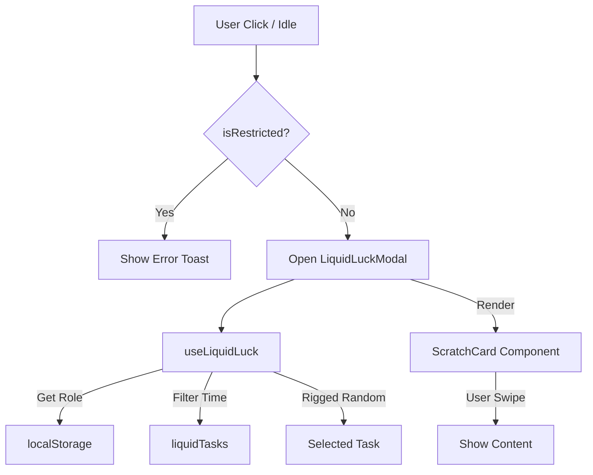

# Feature Documentation: Liquid Luck (Chất Lỏng May Mắn)

## 1. Overview

**Liquid Luck** is a **Rigged Interaction Mini-game** disguised as a random "Potion Mixer".
It serves as a playful "excuse" for "Anh" to pamper "Em" or for "Em" to exercise her authority.
The core philosophy is **"The House Always Wins"** (and "Em" is The House).

---

## 2. Functional Specifications

### 2.1. One-time Setup (The Ritual)

- **Description:** Users must select their role on their own device.
- **Logic:**
  - Persist role selection (`anh` | `em`) to `localStorage`.
  - This determines the visual theme and the Content Pool drawn.

### 2.2. Triggers (Activation)

- **Restriction Check:** Before any activation, checks `src/lib/restriction.ts`.
  - If `isRestricted() === true` -> Show generic access toast -> Block feature.
- **Manual Trigger:** Floating "Potion/Bubble" icon on the interface.
- **Idle Trigger:** Automatically prompts if App is open but inactive for > 30 minutes (Excluding sleep time `23:00 - 12:00`).

### 2.3. The Mixing (Interaction)

- **Visual:** A container of liquid oscillating with device movement (Gyroscope).
- **Theme:**
  - **Anh:** Cyan/Blue Gradient (`from-cyan-500/20 to-blue-500/10`).
  - **Em:** Pink/Rose Gradient (`from-pink-500/20 to-rose-500/10`).
- **Action:** Tap & Hold to "Mix".

### 2.4. The Scratch (Reveal)

- **Visual:** A frosted glass card (`backdrop-blur-md`).
- **Action:** User swipes finger to "scratch" off the frost (Alpha Masking).
- **Content:**
  - **Anh:** Penalties/Duties (Massage, Kiss, Service).
  - **Em:** Rewards/Rights (Skip, Command, Be served).
- **Rigged Rate:**
  - **Anh:** 70% Duties, 30% "Double Trouble" (Both funny).
  - **Em:** 70% Rewards, 30% "Lucky" (Bonus).

---

## 3. System Architecture

### 3.1. File & Component Map

| Location | Component/File | Role & Implementation Details |
| :--- | :--- | :--- |
| **Data Source** | `src/data/liquidLuck.ts` | **Configuration.** Interfaces, Style Tokens, and Task Pools. |
| **Logic Hook** | `src/hooks/useLiquidLuck.ts` | **Brain.** Manages RNG logic, TimeOfDay filtering, and `localStorage` persistence. |
| **Core UI** | `src/components/liquid/LiquidContainer.tsx` | **Visuals.** Renders the liquid effect (SVG/Canvas). |
| **Core UI** | `src/components/liquid/ScratchCard.tsx` | **Interaction.** Handling canvas drawing for "scratch" effect. |
| **Modal** | `src/components/LiquidLuckModal.tsx` | **Orchestrator.** Connects Hook and UI. Handles Restriction check. |
| **Restriction**| `src/lib/restriction.ts` | **Gatekeeper.** Ensures feature is locked until trip date. |

### 3.2. Data Flow



---

## 4. Data & Configuration

- **Config File:** `src/data/liquidLuck.ts`
- **Main Interfaces:**
  ```typescript
  export interface LiquidTask {
    id: string;
    content: string;
    description?: string;
    type: 'dare' | 'reward' | 'spicy';
    targetRole: 'anh' | 'em' | 'both';
    spicyLevel: 1 | 2 | 3;
    timeOfDay?: ('morning' | 'afternoon' | 'night' | 'late_night')[];
  }
  ```

---

## 5. Implementation Guide

### Step 1: Restriction Integration
Unlike other features, Liquid Luck is "locked" until the trip starts.
Inside the **Floating Bubble** click handler (similar to `EasterEggLayer`):
```typescript
import { handleRestrictedAction } from '@/lib/restriction';

const onOpenLiquidLuck = () => {
  if (handleRestrictedAction('Liquid Luck')) return;
  setShowModal(true);
};
```

### Step 2: The Logic Hook
Create `useLiquidLuck` to handle the "Rigged" logic:
- Get current hour.
- Filter `liquidTasksAnh` or `liquidRewardsEm` based on `timeOfDay`.
- Pick a random item (biased towards higher spicy level at night).

### Step 3: Visuals
- Use **SVG Filters** (`feTurbulence`) for the liquid effect to keep it lightweight (vs WebGL).
- Use **HTML5 Canvas** `globalCompositeOperation = 'destination-out'` for the Scratch Card.

---

## 6. QA Checklist

1.  [ ] **Restriction:** Change date < Trip Date -> Click Trigger -> Expect Toast Error.
2.  [ ] **Unlock:** Change date >= Trip Date -> Click Trigger -> Expect Modal Open.
3.  [ ] **Role Consistency:** Select "Anh" -> Restart App -> Should still be "Anh" and show Blue Gradient.
4.  [ ] **Rigged Logic:**
    - Role "Anh" should mostly get `dare` tasks.
    - Role "Em" should mostly get `reward` tasks.
5.  [ ] **Scratch UX:** Swiping should interactively reveal content without lag.
