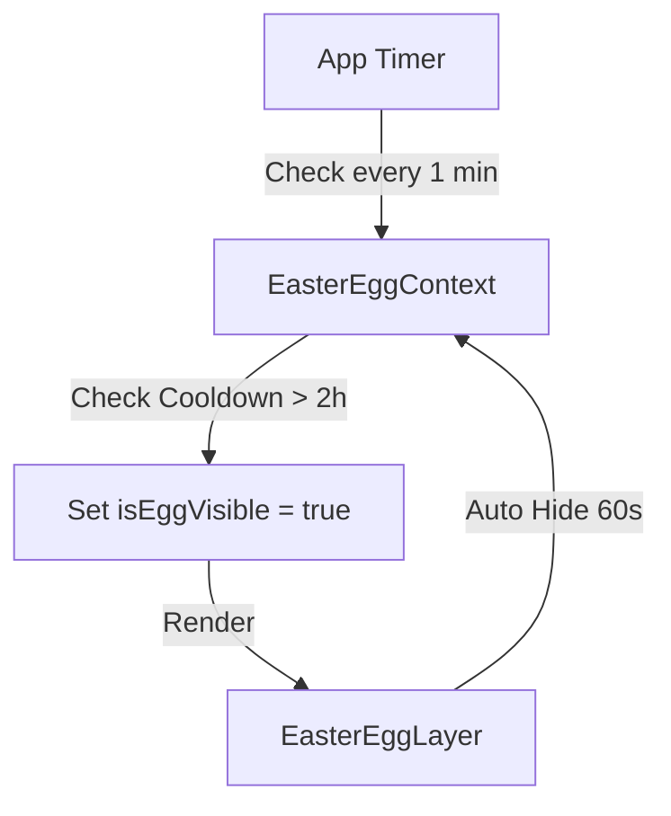
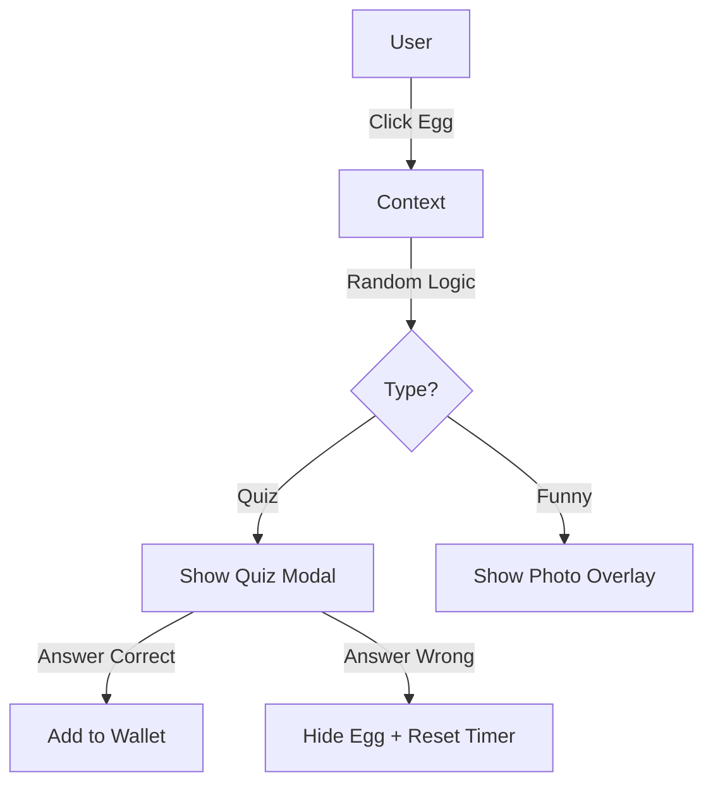

# Feature Documentation: Love Easter Eggs System

## 1. Overview

The **Love Easter Eggs** system is a **Hidden Interaction Layer** designed to enhance the emotional experience and create surprises for the user throughout the trip.

The system consists of 3 main coordinated modules:

1.  **Easter Egg Hunt:** Appears randomly, containing Quizzes or fun content.
2.  **Mood Station:** A place for users to proactively check-in their mood.
3.  **Voucher Wallet:** A place to store and use collected rewards.

---

## 2. Functional Specifications

### 2.1. The Easter Egg (Surprise Hunt)

- **Description:** A floating icon (egg, gift box, or heart) appears unexpectedly on the screen.
- **Spawn Logic:**
  - **Condition:** Current Time > (Last Interaction Time + 2 hours).
  - **Position:** Random coordinates `(top, left)` within the available area (excluding Header & BottomNavbar).
  - **Effect:** Fade In + Floating animation (gentle up/down).
  - **Time-to-live:** Automatically disappears after **1 minute** if not touched.
- **Random Content:**
  - **90% - Daily Quiz:** Multiple-choice questions about memories/preferences. Correct answer gets a Voucher. Wrong answer loses the turn (1-hour Cooldown).
  - **10% - Memory Capsule / Funny:**
    - **Memory Capsule:** Memories flooding back chronologically (First date, Company, Cat Ba, Red hair...).
    - **Funny Moment:** Humorous "unflattering" photos.

### 2.2. Mood Station

- **Description:** An always-visible feature for users to relieve their emotions.
- **Upgrade:** Supports **Photo Album** (Slide/Gallery) display instead of a single image.
- **Access:** Via the "Heart" icon on the new Bottom Navigation.
- **Operational Flow:**
  1.  Select an emotion from the list (Cold, Hungry, Missing, Grumpy...).
  2.  System displays a **Full-screen Overlay** containing corresponding memory images/videos with a message.

### 2.3. Voucher Wallet

- **Description:** Storage for "trophies" from Quizzes.
- **Access:** Via the "Wallet/Ticket" icon on the new Bottom Navigation.
- **Redeem Security:**
  - To use a Voucher, the user must press "Use" and hand the device to the Partner.
  - Partner enters the hardcoded password: **`16012005`**.
  - Successful authentication -> Voucher status changes to "Used" (User Forever).

---

## 3. System Architecture

### 3.1. File & Component Map

| Location         | Component/File                      | Role & Implementation Details                                                                                        |
| :--------------- | :---------------------------------- | :------------------------------------------------------------------------------------------------------------------- |
| **Global State** | `src/contexts/EasterEggContext.tsx` | **Core Logic.** Manages egg spawn timer, wallet state, cooldown, and list of answered quizzes.                       |
| **App Root**     | `src/App.tsx`                       | Wraps `EasterEggProvider` outside Router for global state. Renders `EasterEggLayer` at the top level.                |
| **Overlay UI**   | `src/components/EasterEggLayer.tsx` | Renders floating Egg button based on `isEggVisible` state and `eggPosition` from Context.                            |
| **Navigation**   | `src/components/BottomNavbar.tsx`   | Adds 2 new buttons: `Mood` (Heart Icon) and `Wallet` (Ticket/Wallet Icon). Callbacks invoke `onMood` and `onWallet`. |
| **Page Layout**  | `src/pages/TimelinePage.tsx`        | Manages Modal display state (`showMood`, `showWallet`). Integrates `BottomSheet` to display content.                 |
| **Content UI**   | `src/components/MoodStation.tsx`    | Grid for selecting emotion icons & Logic for displaying photo overlay.                                               |
| **Content UI**   | `src/components/VoucherWallet.tsx`  | Grid displaying Voucher list & Password input Popup.                                                                 |

### 3.2. Data Flow

**1. Spawn Flow:**



**2. Interaction Flow:**



---

## 4. Data & Configuration

- **Config File:** `src/data/easterEggs.ts`
- **Main Interfaces:**

  ```typescript
  interface QuizData {
  	id;
  	question;
  	image?;
  	options;
  	reward;
  }
  interface MoodCheckinData {
  	options: { response: { images: string[]; message } };
  } // Support Album
  interface MemoryCapsuleData {
  	id;
  	title;
  	dateLabel;
  	description;
  	images: string[];
  } // New
  ```

- **Assets Path:** `public/images/easter-eggs/`
  - All images/videos must be placed in this directory.
  - Path in code: `/images/easter-eggs/filename.jpg`.

---

## 5. Implementation Guide (Step-by-Step)

### Step 1: Setup Context (Brain)

Create `EasterEggContext` to keep the heartbeat of the system. Use `localStorage` to persist:

- `lastInteraction`: Timestamp of the last interaction.
- `unlockedVouchers`: Array of IDs of received vouchers.
- `usedVouchers`: Array of IDs of used vouchers.

### Step 2: Create UI Layer (Face)

Create `EasterEggLayer` component (`position: fixed`, `z-index: 50`).

- Use `framer-motion` for floating animation and appearance effects (scale up).

### Step 3: Integrate Navigation (Hands)

Update `BottomNavbar`:

- Add Heart icon (for Mood) and Ticket icon (for Wallet).
- Ensure responsiveness; if there are too many buttons, consider smaller icons or a horizontal scroll bar.

### Step 4: Build Content Modals (Body)

Utilize the existing `BottomSheet` component:

- **MoodStation:** Render a grid of icons. Click -> Open Overlay to view photos (use `ImageViewer` component or custom implementation).
- **VoucherWallet:** Render a grid of cards. Click card -> Open Password Input Dialog.

---

## 6. QA Checklist

1.  [ ] **Spawn Logic:** Adjust computer clock to fast forward 2 hours -> Check if the egg appears.
2.  [ ] **Timeout:** Let the egg appear but do not click -> Should automatically disappear after 1 minute.
3.  [ ] **Quiz Flow:**
    - Answer Correct -> Notification of reward -> Wallet shows the voucher lit up.
    - Answer Wrong -> Egg disappears immediately -> Vibration (if haptic available) -> Does not reappear immediately.
4.  [ ] **Redeem Flow:**
    - Enter Wallet -> Select Voucher -> Enter wrong pass -> Show error.
    - Enter pass `16012005` -> Voucher turns gray (Used) -> Reload app persists Used state.
5.  [ ] **Mood Flow:** Select icon -> Shows correct images/video with corresponding caption.
