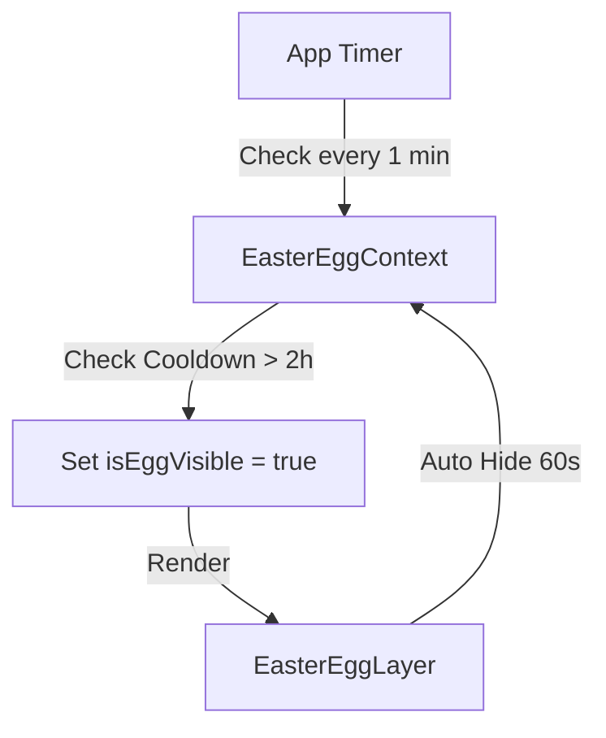
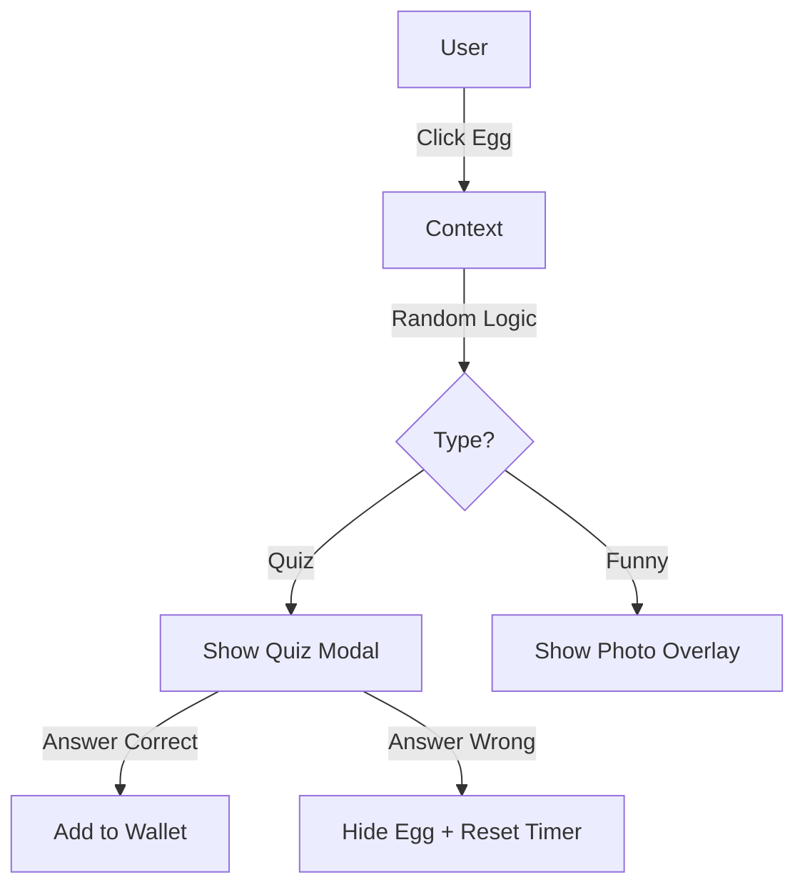

# Feature Documentation: Love Easter Eggs System

## 1. Tổng Quan (Overview)

Hệ thống **Love Easter Eggs** là một tầng tương tác đặc biệt (Hidden Interaction Layer) được xây dựng để tăng cường trải nghiệm cảm xúc và tạo bất ngờ cho người dùng trong suốt chuyến đi.

Hệ thống bao gồm 3 module chính hoạt động phối hợp:

1.  **Easter Egg Hunt (Săn Trứng):** Xuất hiện ngẫu nhiên, chứa Quiz hoặc nội dung vui.
2.  **Mood Station (Trạm Cảm Xúc):** Nơi người dùng chủ động check-in tâm trạng.
3.  **Voucher Wallet (Ví Tình Yêu):** Nơi lưu trữ và sử dụng phần thưởng đã sưu tầm được.

---

## 2. Chi Tiết Chức Năng (Functional Specifications)

### 2.1. The Easter Egg (Săn Trứng Bất Ngờ)

- **Mô tả:** Một biểu tượng trôi nổi (quả trứng, hộp quà, hoặc tim) xuất hiện bất ngờ trên màn hình.
- **Logic Xuất hiện (Spawn Logic):**
  - **Điều kiện:** Thời gian hiện tại > (Thời gian tương tác cuối + 2 giờ).
  - **Vị trí:** Random tọa độ `(top, left)` trong vùng khả dụng (trừ Header & BottomNavbar).
  - **Hiệu ứng:** Fade In + Floating animation (lên xuống nhẹ).
  - **Time-to-live:** Tự động biến mất sau **1 phút** nếu không được chạm vào.
- **Nội dung (Random Content):**
  - **90% - Daily Quiz:** Câu hỏi trắc nghiệm về kỷ niệm/sở thích. Trả lời đúng nhận Voucher. Trả lời sai mất lượt (Cooldown 1 tiếng).
  - **10% - Memory Capsule / Funny:**
    - **Memory Capsule:** Ký ức ùa về theo dòng thời gian (Ngày đầu, Công ty, Cát Bà, Tóc đỏ...).
    - **Funny Moment:** Ảnh dìm hàng vui vẻ.

### 2.2. Mood Station (Trạm Cảm Xúc)

- **Mô tả:** Tính năng luôn hiển thị để người dùng giải tỏa cảm xúc.
- **Nâng cấp:** Hỗ trợ hiển thị **Album ảnh** (dạng Slide) thay vì chỉ 1 ảnh đơn lẻ.
- **Truy cập:** Qua nút biểu tượng "Trái Tim" trên thanh Bottom Navigation mới.
- **Luồng hoạt động:**
  1.  Chọn cảm xúc từ danh sách (Lạnh, Đói, Nhớ, Dỗi...).
  2.  Hệ thống hiển thị **Full-screen Overlay** chứa hình ảnh/video kỷ niệm tương ứng kèm lời nhắn dặn dò.

### 2.3. Voucher Wallet (Ví Voucher)

- **Mô tả:** Kho lưu trữ "chiến lợi phẩm" từ các Quiz.
- **Truy cập:** Qua nút biểu tượng "Ví/Vé" trên thanh Bottom Navigation mới.
- **Bảo mật sử dụng (Redeem Security):**
  - Để sử dụng Voucher, người dùng phải bấm "Dùng" và đưa máy cho Partner.
  - Partner nhập mật khẩu cứng: **`16012005`**.
  - Xác thực thành công -> Voucher chuyển trạng thái "Đã Dùng" (User Forever).

---

## 3. Kiến Trúc Kỹ Thuật (System Architecture)

### 3.1. Sơ đồ File & Component Map

| Vị trí           | Component/File                      | Vai trò & Implement Detail                                                                                 |
| :--------------- | :---------------------------------- | :--------------------------------------------------------------------------------------------------------- |
| **Global State** | `src/contexts/EasterEggContext.tsx` | **Core Logic.** Quản lý timer spawn trứng, trạng thái wallet, cooldown, và danh sách quiz đã trả lời.      |
| **App Root**     | `src/App.tsx`                       | Bọc `EasterEggProvider` ra ngoài Router để state tồn tại toàn cục. Render `EasterEggLayer` ở cấp cao nhất. |
| **Overlay UI**   | `src/components/EasterEggLayer.tsx` | Render nút Trứng trôi nổi dựa trên state `isEggVisible` và `eggPosition` từ Context.                       |
| **Navigation**   | `src/components/BottomNavbar.tsx`   | Thêm 2 nút mới: `Mood` (Heart Icon) và `Wallet` (Ticket/Wallet Icon). Callback gọi `onMood` và `onWallet`. |
| **Page Layout**  | `src/pages/TimelinePage.tsx`        | Quản lý state hiển thị Modal (`showMood`, `showWallet`). Tích hợp `BottomSheet` để hiển thị nội dung.      |
| **Content UI**   | `src/components/MoodStation.tsx`    | Grid chọn icon cảm xúc & Logic hiển thị overlay ảnh.                                                       |
| **Content UI**   | `src/components/VoucherWallet.tsx`  | Grid hiển thị danh sách Voucher & Popup nhập Password.                                                     |

### 3.2. Luồng Dữ Liệu (Data Flow)

**1. Spawn Flow:**



**2. Interaction Flow:**



---

## 4. Dữ Liệu & Cấu Hình (Data Configuration)

- **File Config:** `src/data/easterEggs.ts`
- **Interface chính:**

  ```typescript
  interface QuizData {
  	id;
  	question;
  	image?;
  	options;
  	reward;
  }
  interface MoodCheckinData {
  	options: { response: { images: string[]; message } };
  } // Support Album
  interface MemoryCapsuleData {
  	id;
  	title;
  	dateLabel;
  	description;
  	images: string[];
  } // New
  ```

- **Assets Path:** `public/images/easter-eggs/`
  - Tất cả ảnh/video phải được đặt trong thư mục này.
  - Đường dẫn trong code: `/images/easter-eggs/filename.jpg`.

---

## 5. Hướng Dẫn Implement Chi Tiết (Step-by-Step)

### Bước 1: Setup Context (Brain)

Tạo `EasterEggContext` để giữ nhịp tim cho cả hệ thống. Sử dụng `localStorage` để lưu:

- `lastInteraction`: Timestamp lần cuối chơi.
- `unlockedVouchers`: Mảng ID các voucher đã nhận.
- `usedVouchers`: Mảng ID các voucher đã dùng.

### Bước 2: Tạo UI Layer (Face)

Tạo component `EasterEggLayer` tuyệt đối (`position: fixed`, `z-index: 50`).

- Sử dụng `framer-motion` cho hiệu ứng trôi nổi (floating) và xuất hiện (scale up).

### Bước 3: Tích hợp Navigation (Hands)

Sửa `BottomNavbar`:

- Thêm icon Heart (cho Mood) và Ticket (cho Wallet).
- Đảm bảo responsive, nếu nhiều nút quá có thể dùng icon nhỏ hơn hoặc thanh trượt ngang.

### Bước 4: Xây dựng Content Modals (Body)

Tận dụng component `BottomSheet` có sẵn:

- **MoodStation:** Render lưới các icon. Khi click -> Mở Overlay xem ảnh (dùng component `ImageViewer` hoặc tự custom).
- **VoucherWallet:** Render lưới thẻ bài (Card). Click thẻ -> Mở Dialog nhập pass.

---

## 6. Checklist Kiểm Thử (QA Checklist)

1.  [ ] **Spawn Logic:** Chỉnh đồng hồ máy tính để tua nhanh 2 tiếng -> Kiểm tra trứng có hiện không.
2.  [ ] **Timeout:** Để trứng hiện nhưng không bấm -> Sau 1 phút phải tự mất.
3.  [ ] **Quiz Flow:**
    - Trả lời đúng -> Thấy thông báo nhận quà -> Vào Wallet thấy voucher sáng lên.
    - Trả lời sai -> Trứng biến mất ngay -> Rung (nếu có haptic) -> Không hiện lại ngay.
4.  [ ] **Redeem Flow:**
    - Vào Wallet -> Chọn Voucher -> Nhập sai pass -> Báo lỗi.
    - Nhập pass `16012005` -> Voucher chuyển màu xám (Used) -> Reload app vẫn giữ trạng thái Used.
5.  [ ] **Mood Flow:** Chọn icon -> Ra đúng ảnh/video với caption tương ứng.
